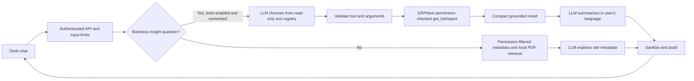

# Architecture

Every request executes under `frappe.session.user`. `tools/registry.py` is an explicit read-only allow-list. `tools/executor.py` rejects unregistered tools, extra/missing arguments, invalid types, and invalid date ranges. The handlers in `tools/data.py` call `frappe.has_permission` and Frappe `get_list` or the built-in Profit and Loss report. Model-supplied tool names and arguments are never trusted directly. No tool creates, updates, or deletes ERPNext documents.

Business tools stay off by default. A System Manager chooses either a local OpenAI-compatible endpoint, or a hosted model with explicit consent and aggregated results. In hosted mode, the app removes detailed overdue invoice rows before passing results to the model. The LLM sees the question and tool schemas before execution, and only a compact result after the server has checked permissions. API keys remain server-side.

Knowledge retrieval enumerates permitted DocTypes and reads merged metadata with `frappe.get_meta()`. Desk Workspace links are returned only when the logged-in user can read the Workspace. Permission and metadata events invalidate the cached per-user index. The bundled ERPNext PDF index lives in the site's private files.

Provider failures return localized generic text to Desk; provider details are written to Frappe Error Log. AI Interaction Log records user, intent, status, tools, model/provider, duration, and answer. Daily call budgets and per-minute rate limits reduce accidental repeated calls. The settings include a retention period managed by the scheduled cleanup task.

## Current scope and boundaries

The Phase 2 registry currently includes item search, stock balance, overdue invoices, sales totals, and `get_report_data` for the allow-listed Profit and Loss Statement. Employee leave/payroll, arbitrary reports, and any write action are not implemented. Sales totals use the submitted Sales Invoice records visible to the user and company base currency; profit comes from ERPNext's report rather than a locally reconstructed accounting formula.
