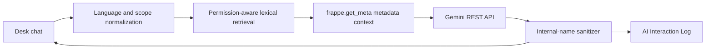

# Architecture

Each request runs as the logged-in Frappe user. Retrieval checks the user's read permission before selecting a DocType, then `frappe.get_meta()` provides the merged standard/custom metadata. No business documents are queried.

## Privacy

In Phase 1, the hosted LLM receives only the question, recent conversation history, and selected Doctype metadata: human labels, visible structure, links, workflow descriptions, Desk location and the user's allowed actions. It does not receive business-record contents, quantities, money, passwords, configuration values, or the Gemini key. The key is used only in the Python backend.
