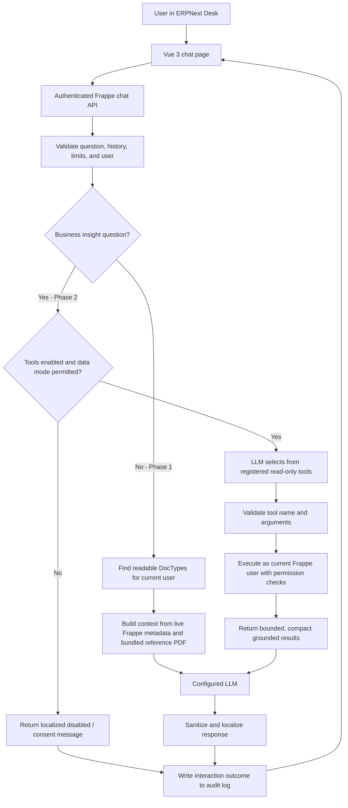

# Architecture and data flow

HW AI Support is a regular Frappe app. Its Desk page is built with Vue 3 and calls an authenticated, server-side Frappe method. The browser never receives the provider credential and never queries ERPNext business tables directly.

## Request flow

### Phase 1: site-aware ERPNext guidance

The backend identifies the question language locally and retrieves relevant content. The metadata index includes only DocTypes that the current user can read. For selected DocTypes, the app builds a compact description from live `frappe.get_meta()` data, translated labels, permitted Desk workspace links, relevant workflows, and readable linked DocTypes. The index is cached per user and invalidated after relevant metadata or permission changes. The app also retrieves relevant passages from the bundled ERPNext reference PDF.

The LLM receives that context with a system prompt that limits answers to this ERPNext site and requires a grounded limitation when context is insufficient. PDF retrieval uses a local TF-IDF index; query terms are normalized and expanded with English/French/Arabic ERPNext synonyms before ranking. This is a lightweight lexical retriever, not a semantic embedding model, so different wording can still miss relevant passages. The response is sanitized before it is returned to Desk. Internal labels may be used for retrieval and sanitization but should not be shown as raw field identifiers.

### Phase 2: permission-checked business insights

The server classifies business-data questions and checks the administrator's tool/data-mode settings. If allowed, the LLM receives the registry of read-only tool schemas. It can request a registered tool, but the server validates the tool name and arguments and runs the handler as `frappe.session.user`. Handlers enforce the relevant DocType permissions and use Frappe's permission-aware list/report APIs. The model does not receive records before the server-side checks.

The result is bounded and summarized. Hosted mode sends only compact aggregates for business data; for example, overdue invoice count and totals rather than invoice-level rows. The LLM turns the verified result into a brief answer in the user's language. Unsupported data requests should be declined or identified as unavailable.

### API and provider boundary

- `hw_ai_support.api.chat` authenticates requests, validates input, applies rate and daily budgets, routes questions, and records chat outcomes.
- `hw_ai_support.llm` is the only module that calls a hosted or OpenAI-compatible model. Provider credentials stay in server-side site configuration or environment variables.
- `hw_ai_support.tools.registry` is the explicit allow-list; `hw_ai_support.tools.executor` validates calls; `hw_ai_support.tools.data` contains permission-checked read-only ERPNext handlers.
- `hw_ai_support.retrieval`, `hw_ai_support.knowledge`, and `hw_ai_support.pdf_retrieval` prepare Phase 1 context.
- `hw_ai_support.sanitizer` removes internal identifiers from generated text before returning it to the client.

## Permissions, privacy, and audit

Every business query runs for the logged-in user. Tool handlers reject a user mismatch and check read permission on the relevant DocTypes. The allow-list does not contain write operations. Hosted business-data mode is disabled by default and requires administrator consent. A System Manager can control question-text retention, personal-data redaction, tool limits, daily budget, and audit-log retention in **HW AI Support Settings**.

Successful, denied, rate-limited, and failed chat attempts are recorded in **AI Interaction Log** where the request reaches the chat handler. Provider diagnostics are recorded in Frappe **Error Log**; credentials must not be put in logs or shared. Scheduled cleanup removes expired interaction logs according to the configured retention period.

## Scope boundary

Current live tools cover item search, stock balance, overdue invoices, sales summaries, and the allow-listed Profit and Loss report. Leave balances, payroll, arbitrary reports, and creating or changing ERPNext documents are out of scope. See [Supported tools and boundaries](tools_and_scope.md).
